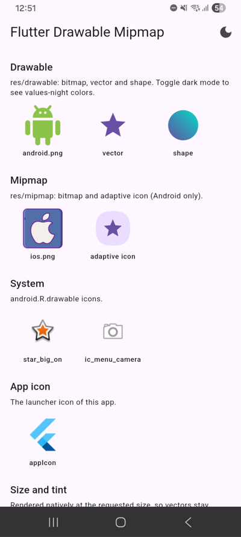
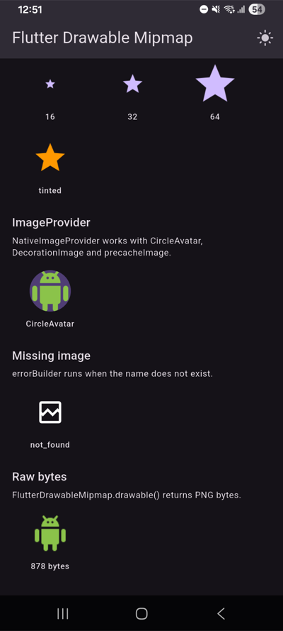
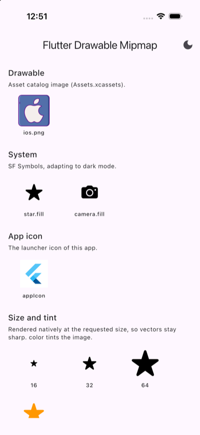
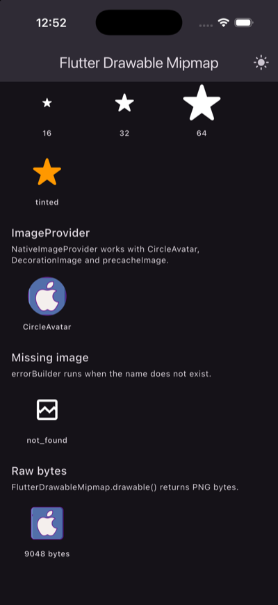

# Flutter Drawable Mipmap

Show native images in Flutter: Android drawables and mipmaps, iOS asset catalog images, system icons
and the app icon.

| Feature  | Android                       | iOS                 |
|----------|-------------------------------|---------------------|
| Drawable | `res/drawable`                | Asset catalog image |
| Mipmap   | `res/mipmap` (adaptive icons) | Not available       |
| System   | `android.R.drawable`          | SF Symbols          |
| App icon | Launcher icon                 | App icon            |

Vectors, shapes and adaptive icons render natively at the requested size. Images are cached,
follow light and dark mode, and load off the UI thread.

| Android                                                                                                                             | Android (dark)                                                                                                                     | iOS                                                                                                                             | iOS (dark)                                                                                                                     |
|-------------------------------------------------------------------------------------------------------------------------------------|------------------------------------------------------------------------------------------------------------------------------------|---------------------------------------------------------------------------------------------------------------------------------|--------------------------------------------------------------------------------------------------------------------------------|
|  |  |  |  |

## Install

```shell
flutter pub add flutter_drawable_mipmap
```

## Usage

```
import 'package:flutter_drawable_mipmap/flutter_drawable_mipmap.dart';

Drawable("logo", width: 48, height: 48)
Mipmap("ic_launcher")
NativeImage.system("star.fill", width: 24, color: Colors.amber)
NativeImage.appIcon(width: 64)
```

Every widget accepts `width`, `height`, `fit`, `color` (tint), `brightness`, `placeholder`,
`errorBuilder` and `semanticLabel`.

### ImageProvider

Use it anywhere Flutter takes an `ImageProvider`:

```
CircleAvatar(backgroundImage: NativeImageProvider.drawable("avatar"))
```

### PNG bytes

```
Uint8List? bytes = await FlutterDrawableMipmap.drawable("logo", width: 48);
```

Also, available: `mipmap`, `system` and `appIcon`. Returns `null` when the image does not exist.

## Android release builds

Resources used only by name can be removed by `shrinkResources`. Keep them in
`android/app/src/main/res/raw/keep.xml`:

```xml

<resources xmlns:tools="http://schemas.android.com/tools"
    tools:keep="@drawable/logo,@mipmap/ic_launcher" />
```

## Migrating from 1.x

- Import `flutter_drawable_mipmap.dart` instead of `image_widget.dart`.
- Replace `FlutterDrawableMipmap.drawableMipmap(name, isDrawable)` with
  `FlutterDrawableMipmap.drawable(name)` or `FlutterDrawableMipmap.mipmap(name)`.
- `Drawable` and `Mipmap` still work as before.

See the [example](example/lib/home_page.dart) for every feature.
